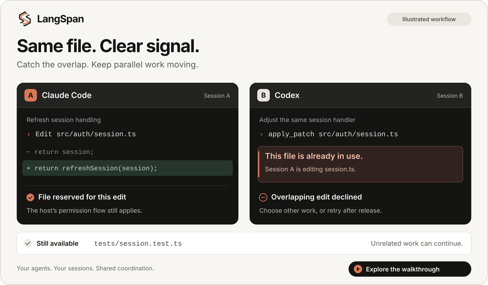

# Your agents. On the same page.

The [LangSpan product website](https://langspan.dev/). LangSpan gives a
team's coding agents a shared view of work in progress. The goal is to help
people build connected parts of a project with less avoidable repair and less
manual relay between their sessions.

[](https://langspan.dev/#team-story)

## Follow the team story

The page starts with a familiar coordination problem: one person's swarm moves
ahead of the team's awareness, and teammates step aside to avoid interference.
An original illustration follows two developers adding session refresh in a
shared checkout, where both sessions can read the changed file. Alice's
agent edits the session handler; Bob's agent receives that update at its next
prompt and inspects the handler before editing the login flow.

The complete story is visible without playback or JavaScript. Play, Pause and
Replay let visitors follow the update between sessions. The response is an
authored illustration, not a recording or measured improvement.

An expandable walkthrough then explains three supported operations:

- Catch an overlap: Agent B tries to edit a file under Agent A's whole-file
  hold, then moves to an unclaimed test file.
- Share the context: Agent B receives Agent A's task and recent file paths at
  session start, followed by an updated briefing on its next prompt.
- See the changes: a Git scan finds a shell edit and records it without
  assigning an author.

All examples run in the browser without contacting an agent or daemon. The
mission section states the outcomes we intend to test, without claiming those
gains have been demonstrated.

## Work on the site

This is buildless HTML, CSS and JavaScript for GitHub Pages. Serve the
repository root with your usual static server; no package installation or build
step is needed. For example:

```sh
python3 -m http.server 8080 --bind 127.0.0.1
```

Open `http://127.0.0.1:8080/`. The page uses no remote fonts, analytics, cookies,
externally hosted scripts or backend. Motion mini is included locally under
its upstream MIT license. JavaScript is optional for reading the product story,
initial example and setup instructions. Reduced-motion preferences and
`?motion=static` disable the added Motion effects.

| File | Purpose |
| --- | --- |
| `index.html` | Team problem, mission, illustrations, setup and availability |
| `assets/site.css` | Responsive layout, focus states and reduced-motion support |
| `assets/site.js` | Walkthrough playback, step selection, setup tabs and copy controls |
| `assets/team-story.css` | Compact two-session illustration and responsive layout |
| `assets/team-story.js` | Explicit story playback, pause and replay |
| `assets/motion-enhancements.js` | Optional Motion transitions and cleanup |
| `assets/vendor/motion-14.14.0/` | Pinned Motion mini build, license and provenance |
| `assets/brand/` | Reference image, corrected vector outlines and organization avatar |
| `assets/product/` | Original product illustration and social preview card |
| `docs/marketing-refresh-plan.md` | Scope, product basis and validation plan |
| `docs/motion-refresh-validation.md` | Motion behavior, fallback and browser verification |

## Brand and product basis

The updated supplied “Swarm Weave” kit anchors the site: warm white `#F4F3EF`,
near-black `#151513`, slate `#3F3E44` and coral `#D87859`.
The [brand assets](assets/brand/README.md) use the updated supplied SVG kit
verbatim, including its outlined lettering and palette. `langspan-avatar.png`
is a padded export of that mark for GitHub.
The product illustrations use the same original vector paths. Composition, copy
and walkthrough code were created for LangSpan.

The core repository is [Langspan/Langspan](https://github.com/Langspan/Langspan).
It currently requires access. The page shows single-project hook setup.
The [core setup guide](https://github.com/Langspan/Langspan/blob/main/docs/usage.md#connect-a-native-agent)
also covers user-level hooks and MCP registration across Git repositories.
Both setup paths use the same product and supported-tool limits.
[Implementation status](https://github.com/Langspan/Langspan/blob/main/docs/IMPLEMENTATION_STATUS.md)
holds the recorded evidence and remaining verification work.
[The mission](https://github.com/Langspan/Langspan/blob/main/docs/mission.md)
owns the problem, product hypothesis and success measures. Teams are the main
audience; one developer running several agents is also a useful entry point.
The page describes opt-in remote briefings, check-and-landing commands,
region admission, the optional read-only dashboard and the name-based source
index in the source preview. Interface notices remain within one physical
workspace.

One [retained native run](https://github.com/Langspan/Langspan/blob/main/docs/evidence/mixed-hosts/README.md)
records Claude Code and Codex taking sequential turns in one shared checkout:
Codex completed an edit, Claude preserved its change, and Codex later declined
to edit without rereading the file. Simultaneous mixed-host conflicts, live
agents in linked worktrees, a completed two-machine run and comparative
reductions in rework remain unverified. The page's authored illustrations are
separate from this retained run.

Copy follows the core repository's `brand-voice`, `anti-slop-writing` and
`readme-glow-up` skills: one headline, then sentences that name the agent, file
and action. Product behavior comes from the implementation and its evidence.

## Review changes

Page and UI work uses [Impeccable](https://github.com/pbakaus/impeccable)
for design critique, focused refinement and final review alongside the existing
brand and product evidence. [AGENTS.md](AGENTS.md) records the workflow for
contributors and coding agents.

Check every story and step, Play/Pause, replay, keyboard tabs, copy fallback and
both setup variants. Inspect desktop and narrow layouts with normal and reduced
motion when changing layout. Keep availability beside setup and planned features
labelled.
Publish through a feature branch and pull request to this GitHub Pages repo.
