# Your agents. On the same page.

**Run agents in parallel. Build as a team.**

[](https://github.com/Langspan/LangSpan.dev/releases/latest) [](https://github.com/Langspan/langspan.github.io/actions/workflows/pages.yml) [](https://github.com/Langspan/langspan.github.io/actions/workflows/verify-live-marketing.yml) [](https://langspan.dev/)

[](https://github.com/Langspan/langspan.github.io/blob/main/demo-src/package.json) [](https://github.com/Langspan/langspan.github.io/blob/main/demo-src/package.json)

<sub>Release badge tracks the core product; React and esbuild badges track the site’s pinned build dependencies. See the [marketing toolchain](marketing/skills.lock.json) for vendored components and upstream revisions.</sub>

The [LangSpan product website](https://langspan.dev/) introduces the open-source coordination
layer for parallel agentic development. Worktrees isolate files, not intent.
LangSpan complements your agents and Git workflows with relevant briefings,
supported local edit checks, session ownership and exact-tree check evidence.
The goal is compatible parallel work with less avoidable repair and manual
relay; comparative outcomes remain to be measured.

The [canonical product positioning](https://github.com/Langspan/LangSpan.dev/blob/main/docs/positioning.md)
owns public messaging and evidence boundaries.
[LangSpan Live](https://langspan.dev/#langspan-live) · [Parallel work](https://langspan.dev/#scale) · [Semantic conflict](https://langspan.dev/#why) ·
[Research](https://langspan.dev/#research) · [Recorded evidence](https://langspan.dev/#evidence)

<a href="https://langspan.dev/#edit-coordination">
  <picture>
    <source media="(max-width: 600px) and (prefers-reduced-motion: reduce) and (prefers-color-scheme: dark)" srcset="assets/product/langspan-card-compact-dark-still.svg">
    <source media="(max-width: 600px) and (prefers-reduced-motion: reduce)" srcset="assets/product/langspan-card-compact-light-still.svg">
    <source media="(max-width: 600px) and (prefers-color-scheme: dark)" srcset="assets/product/langspan-card-compact-dark.svg">
    <source media="(max-width: 600px)" srcset="assets/product/langspan-card-compact-light.svg">
    <source media="(prefers-reduced-motion: reduce) and (prefers-color-scheme: dark)" srcset="assets/product/langspan-card-dark-still.svg">
    <source media="(prefers-reduced-motion: reduce)" srcset="assets/product/langspan-card-light-still.svg">
    <source media="(prefers-color-scheme: dark)" srcset="assets/product/langspan-card-dark.svg">
    
  </picture>
</a>

*An authored 12-second illustration of local coordination, not a session recording.
[Explore each step](https://langspan.dev/#edit-coordination) with Play, Pause and Replay, or open
the motionless [light](assets/product/langspan-card-light-still.svg) or
[dark](assets/product/langspan-card-dark-still.svg) version.*

## Explore six capabilities

The [product page](https://langspan.dev/) leads with parallel agentic development: an interactive 2/6/10-session local/cloud illustration, a reproducible clean-merge semantic failure, source-index awareness, attributed independent research, the coordination layer, six-capability explorer, local-first architecture, recorded evidence and setup. The scale illustration is not a concurrency benchmark. The semantic example is reproduced with real Git and Node in `review/semantic-git-example.mjs`; no model or LangSpan runs in that fixture. The hypothetical briefing-assisted recovery is explicitly labelled.

[Semantic awareness](https://langspan.dev/#semantic-awareness) shows the narrower
v0.1.0 source-index mechanism: local name matching and advisory argument-count
alerts, not resolved dependencies or automatic repair. Run
`LANGSPAN_BIN=/path/to/langspan node review/source-awareness-proof.mjs` to
exercise the released Linux binary with synthetic events in a temporary Git
repository. The fixture checks an admitted incompatible caller request and its
actual advisory output. No model runs. Rename and removal alerts and linked-worktree uncommitted signature notices
ship in v0.2.0. Same-count type/order checks and
cross-machine symbol publication remain future work. The four-part architecture groups semantic
awareness and coordination within LangSpan; agents retain execution.

[Peer briefings](https://langspan.dev/#peer-briefings),
[edit coordination](https://langspan.dev/#edit-coordination),
[source awareness](https://langspan.dev/#source-awareness),
[commit ownership](https://langspan.dev/#commit-ownership),
[team awareness](https://langspan.dev/#team-awareness), and
[integration checks](https://langspan.dev/#integration-checks) use actual
vendored Stageshow components and the source-backed scenes in
`marketing/story.json`. Each has a finite timeline, manual steps, replay,
a capability-specific scope statement and evidence link. The original
four-step collision demo remains the edit-coordination tab and canonical
README/film narrative. All content works as ordinary HTML without JavaScript.

The primary demonstration uses a selectively vendored Stageshow React kit,
including `Stage`, `Window`, `Prompt`, `Code`, `Roll` and `Collapse`. It is an
authored product illustration, not a session recording, literal CLI output or
measured result. Its generic Agent A/B labels do not imply a verified
simultaneous Claude Code/Codex conflict. LangSpan does not choose B's next task.

The hero and demonstration run entirely in the browser without contacting
agents or a coordinator. Playback has a useful final frame, visible controls,
reduced-motion behavior and a static fallback. The mission describes the team
outcomes we intend to test; it does not claim those gains are already measured.

## Marketing media

The [marketing workspace](marketing/README.md) owns the canonical demonstration narrative, version-pinned production tools, film plans, reviewed export manifest and launch copy. The optional [33-second local-coordination film](https://langspan.dev/#film) and short walkthrough use the same Stageshow story and labelled released dashboard evidence. The existing four README-native ChanMeng cards remain lightweight and reproducible.

## Work on the site

GitHub Pages serves static HTML, CSS and JavaScript. The generated demonstration
bundle is committed, so previewing or deploying the site needs no package
installation or whole-site build.

Only the public site is published. The `Deploy website` workflow
(`.github/workflows/pages.yml`) runs `tools/assemble-site.sh`, which copies
`index.html`, `404.html`, `robots.txt`, `sitemap.xml`, `CNAME` and `assets/`
into `_site` and deploys that folder. Documentation, review scripts, marketing
sources, `demo-src/` and agent instructions stay in the repository and are not
served. A new public file outside `assets/` must be added to that script.
Run `sh tools/assemble-site.sh` to check the allowlist and the page's local
references before opening a pull request.

Serve the repository root for a preview, for example:

```sh
python3 -m http.server 8080 --bind 127.0.0.1
```

Open `http://127.0.0.1:8080/`. The animation code and Motion mini are local
assets. JavaScript enhances the story; the page's copy, setup instructions and
static demonstration remain available without it. Reduced-motion preferences
and `?motion=static` present the stories without animated playback.

When changing the Stageshow demonstration source, rebuild that one asset:

```sh
cd demo-src
npm ci --ignore-scripts
npm run build
```

This runs the pinned esbuild tool through `demo-src/build.mjs`, producing
`assets/coordination-demo.js`. Commit source and generated output together.
There is no React application build for the rest of the site. The
[demo guide](demo-src/README.md) describes mounting, playback, fallback and
the shared pause control; its [source manifest](demo-src/UPSTREAM.json)
records the pinned upstream files and the one local `Stage` extension.

| File | Purpose |
| --- | --- |
| `index.html` | Shared-awareness hero, team problem, demonstration, scope, mission, setup and FAQ |
| `assets/site.css` | Responsive layout, focus states and reduced-motion support |
| `assets/site.js` | Page interactions, setup choices, copy controls and motion coordination |
| `assets/shared-work-canvas.js` | Original hero connection animation informed by living-canvas |
| `demo-src/` | React demonstration source, selected Stageshow kit, pinned dependencies and build script |
| `assets/coordination-demo.js` | Generated, self-contained Stageshow demonstration bundle |
| `assets/vendor/motion-14.14.0/` | Pinned Motion mini build, license and provenance |
| `assets/fonts/inter-5.2.5/` | Self-hosted Inter variable font (Latin subset), OFL licence and provenance |
| `assets/brand/` | Exact approved SVG kit, reference image and organization avatar |
| `assets/product/` | Existing animated README illustrations and social preview card |
| `docs/marketing-overhaul.md` | Redesign decisions, source provenance and recorded verification |
| `docs/readme-animation.md` | Card storyboard, source references, embedding and verification |

Earlier refresh and validation documents record earlier versions of the site;
they do not establish that this redesign passed those checks. Record new
verification in `docs/marketing-overhaul.md`, and distinguish source inspection
from rendered browser checks.

## Brand and product basis

The updated supplied “Swarm Weave” kit anchors the site: warm white `#F4F3EF`,
near-black `#151513`, slate `#3F3E44` and coral `#D87859`.
The [brand assets](assets/brand/README.md) use the updated supplied SVG kit
verbatim, including its outlined lettering and palette. `langspan-avatar.png`
is a padded export of that mark for GitHub.
Keep the supplied mark and wordmark intact. The page's composition, copy and
product scenarios were created for LangSpan. Stageshow supplies selected scene
components; living-canvas informs the hero's visual storytelling rather than
supplying a copied runtime. Their provenance and licences are recorded with
the implementation.

The v0.1.0 release provides four macOS/Linux binary archives. The homepage now prioritizes downloading a binary and connecting one checkout; source builds remain available. See [release readiness](docs/launch-readiness.md).

The core repository is [Langspan/LangSpan.dev](https://github.com/Langspan/LangSpan.dev).
The source is public and release archives are published. Homebrew is not available. The page shows single-project
hook setup.
The [core setup guide](https://github.com/Langspan/LangSpan.dev/blob/main/docs/usage.md#connect-a-native-agent)
also covers user-level hooks and MCP registration across Git repositories.
Both setup paths use the same product and supported-tool limits.
[Implementation status](https://github.com/Langspan/LangSpan.dev/blob/main/docs/IMPLEMENTATION_STATUS.md)
holds the recorded evidence and remaining verification work.
[The mission](https://github.com/Langspan/LangSpan.dev/blob/main/docs/mission.md)
owns the problem, product hypothesis and success measures. Teams are the main
audience; one developer running several agents is also a useful entry point.
The page focuses on shared awareness and supported edits, with an optional
read-only dashboard for people. Briefings can connect related worktrees;
physical edit holds stay within each checkout. Remote sharing is opt-in and
uses the Git remote. Remote activity informs agents and never denies a local
edit. The setup guide carries the fuller check-and-landing, source-index and
adapter details.

One [retained native run](https://github.com/Langspan/LangSpan.dev/blob/main/docs/evidence/mixed-hosts/README.md)
records Claude Code and Codex taking sequential turns in one shared checkout:
Codex completed an edit, Claude preserved its change, and Codex later declined
to edit without rereading the file. A [Mac/cloud run](https://github.com/Langspan/LangSpan.dev/blob/main/docs/evidence/two-machine/README.md)
also records briefings reaching real sessions in both directions, without a
change to an agent's edit because of the briefing. The implementation status
also reports Claude Code linked-worktree briefings in a later launch
validation, whose evidence files were not published. A [real Codex run](https://github.com/Langspan/LangSpan.dev/blob/main/docs/evidence/codex-real-host/README.md)
records a Codex edit refused while a live Claude Code session held the same
function; that session's edit was waiting at its permission prompt, not
writing. Two agents writing at the same moment, and comparative reductions in
team rework or manual relay, remain unverified. Cursor and Gemini CLI adapters are built from documentation and
have no verified live session. The page's authored illustrations are separate
from these evidence records.

Supported edit checks do not cover every filesystem write. Writes outside the
hooks and edits approved after a hold expires can proceed; shell coverage is
partial. The host's own permissions still decide what can run. Keep those
limits and current availability near setup without making the product story
an engineering manual.

Copy follows the canonical mission, approved brand and Impeccable guidance:
one clear headline, then sentences that name the agent, file and action.
Derive current behavior from implementation and evidence rather than assuming
older documentation or a passing parser test proves a live-host outcome.

## Review changes

Page and UI work uses [Impeccable](https://github.com/pbakaus/impeccable)
for design critique, focused refinement and final review alongside the existing
brand and product evidence. [AGENTS.md](AGENTS.md) records the workflow for
contributors and coding agents.

Check the hero and every demonstration step, Play/Pause, Replay, keyboard
controls, copy fallback and setup choices. Inspect desktop and narrow layouts,
normal and reduced motion, JavaScript disabled, and behavior when the page or
demonstration is offscreen. Keep availability beside setup. Report only checks
actually performed, with the source revision and remaining limitations.
Publish through a feature branch and pull request to this GitHub Pages repo.

## Interactive experience

The benchmark explorer at `#benchmark` presents the implemented K1 harness
(three task families, isolated-clone controls and linked worktrees with one coordinator in the LangSpan arm), not valid comparative
results. The scope and evidence selectors and source-build setup preview
extend the existing site in `assets/experience.css` and `assets/experience.js`.
The real Stageshow bundle and current release installation remain unchanged.

## v0.2.0 website

The current installation path uses the v0.2.0 binaries and `langspan setup`. The [LangSpan Live demo](https://langspan.dev/#langspan-live) uses the release's actual renderer and labeled fictional scenes; the older dashboard evidence remains unchanged. The benchmark explorer reflects the current harness design, not comparative results.

## Release links

The stable release page is https://github.com/Langspan/LangSpan.dev/releases/latest. On the website, `assets/latest-release.js` resolves the public latest-release API once per page load. A complete stable release updates the version label, four platform links, matching checksums and tag link as one set. If the API is unavailable or the assets are incomplete, the labeled v0.2.0 fallback remains usable. A new release does not require a website deployment. Capability and evidence statements remain versioned and are reviewed separately.
